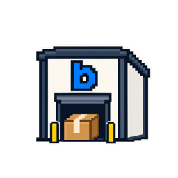
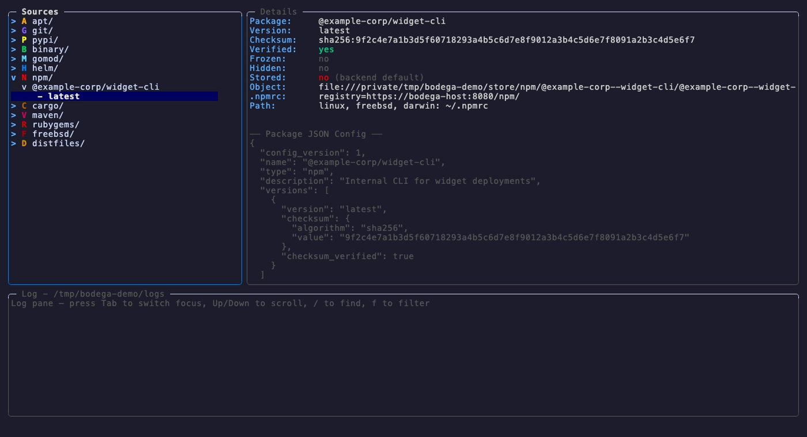

# bodega



[](https://github.com/ravinald/bodega/actions/workflows/ci.yml)
[](https://pkg.go.dev/github.com/ravinald/bodega)
[](LICENSE)

bodega is a self-hosted package repository for the hosts you run. It mirrors, builds, and serves twelve package types to their native clients, so `apt-get`, `pip`, `npm`, `go`, `cargo`, `gem`, `helm`, Maven, Gradle, and FreeBSD's `pkg` all fetch from one server on your network instead of from the internet. Your hosts keep working when an upstream registry is down, compromised, or somewhere they aren't allowed to reach.



Every package is a manifest: a name, a type, and the versions you allow. bodega pins each version's checksum on first fetch, decides at request time whether a version may be served, and records every fetch, change, and refusal in an audit trail. Artifacts live on local disk, in S3, or across several named backends.

## Features

Every package your hosts install passes through bodega, which gives it a few jobs:

- **Serves native protocols.** Clients point at bodega and change nothing else about how they install.
- **Admits versions by policy.** A version can be held back by its publish age, an OSV advisory or malware record, failed upstream provenance, a source allow-list, a name close to a popular package, or an external feed such as a malware list. An operator can lift a block, but only with a second approver and only for a limited time.
- **Signs what it generates.** The apt and FreeBSD repositories bodega builds are signed with its own keys, and it can attest the artifacts it stores.
- **Knows who fetched what.** Tokens, OIDC sign-in, and network bindings tie each request to a host or a person, and scopes separate reading, writing, administration, approvals, and token management.
- **Checks the hosts too.** `bodega doctor` and a served `setup.sh` configure clients, and osquery inventory compares what each host installed with what bodega served it.

| Type      | Client         | Protocol                                    |
| --------- | -------------- | ------------------------------------------- |
| apt       | `apt-get`      | Debian repository                           |
| git       | `git clone`    | Git bundles                                 |
| pypi      | `pip install`  | PEP 503 simple index                        |
| binary    | `curl`         | Direct download                             |
| gomod     | `go get`       | GOPROXY                                     |
| helm      | `helm install` | Chart repository                            |
| npm       | `npm install`  | npm registry                                |
| cargo     | `cargo`        | Sparse registry index                       |
| freebsd   | `pkg`          | pkg repository, mirrored or generated       |
| distfiles | `make fetch`   | Ports distfiles, checked against `distinfo` |

## Install

Build from source with the Go version `go.mod` names:

```bash
git clone https://github.com/ravinald/bodega.git
cd bodega
make build          # ./dist/bodega
sudo make install   # /usr/local/bin, or /opt/homebrew/bin on Apple Silicon
```

The server runs on Linux and FreeBSD. Tagged releases publish signed and attested archives for Linux, macOS, and FreeBSD on amd64 and arm64, with the systemd unit and the rc.d script included; [Security](SECURITY.md#verifying-a-release) shows how to verify one. Until the first tagged release, build from source: `go install ...@latest` resolves to a stale `v0.1.0`.

## Quick start

Add a package, build it, and serve it:

```bash
bodega pkg create git widget     # prompts for the URL and ref
bodega build upload              # fetch, build, and store it
bodega serve --allow-plaintext   # HTTP on :8080, for a local trial
```

Clients point at bodega instead of upstream. With a pypi and a gomod package added the same way:

```bash
pip install --index-url http://localhost:8080/pypi/simple/ examplesdk
GOPROXY=http://localhost:8080/go go get example.com/example-corp/widget-sdk@v1.30.0
```

A real install serves TLS (`--tls-cert` and `--tls-key`). On each client host, the script bodega serves writes every package manager's config in one step, and shows you the diff first:

```bash
curl -fsS -o setup.sh https://bodega.example.com/client/setup.sh
sh setup.sh --url https://bodega.example.com             # prints the diff, writes nothing
sudo sh setup.sh --url https://bodega.example.com --apply
```

[Quick start](docs/quickstart.md) walks through the whole thing, including S3 storage, apt signing, and the client's trust store.

## Commands

Every command takes `--help`, with examples. [Usage](docs/usage.md#commands) covers each one in full.

| Command       | Purpose                                                                                       |
| ------------- | --------------------------------------------------------------------------------------------- |
| `acl`         | Manage the CIDR access lists in the audit database                                            |
| `apt`         | APT repository operations, including signing key management                                   |
| `attest`      | Attestation operations (signing key, verify, backfill)                                        |
| `audit`       | Audit trail and dependency checking                                                           |
| `build`       | Build pipeline: fetch, run, package, upload, sync, status                                     |
| `discover`    | Inspect upstream-fetch observations and promote them to allow-list rules                      |
| `doctor`      | Inspect the host and this install's policy posture for gaps in bodega's controls              |
| `freebsd`     | Manage the signing key for a generated pkg repository                                         |
| `identity`    | Bind tokens and networks to the host names the audit trail records                            |
| `init`        | Create an S3 backend's bucket, print its IAM policies, and check them                         |
| `integration` | External admission checks: list, configure and test them                                      |
| `inventory`   | Inspect inventory sources, map their hosts, and reconcile what hosts installed                |
| `login`       | Sign in through the organization's identity provider and store a short-lived token            |
| `osquery`     | Manage osquery enroll secrets for an osquery inventory source                                 |
| `override`    | Request and approve time-limited, two-person overrides of a blocked admission                 |
| `pin`         | Pin a host to the versions bodega serves                                                      |
| `pkg`         | Package management: create, edit, import, export, convert, delete, freeze, hide, move, verify |
| `policy`      | Manage the upstream source allow-list                                                         |
| `profile`     | Declare what one class of host may fetch                                                      |
| `queue`       | Review what clients asked for and bodega refused, and admit or dismiss it                     |
| `repair`      | Detect and fix inconsistencies in the manifest store                                          |
| `reset`       | Clear all manifests and local artifacts, keeping app config                                   |
| `serve`       | Start the HTTP(S) package server                                                              |
| `shell`       | Launch the interactive TUI                                                                    |
| `show`        | Display repository and package information                                                    |
| `status`      | Show the repository status dashboard                                                          |
| `token`       | Manage API tokens for the mutation API                                                        |

## Documentation

- [Quick start](docs/quickstart.md): one package from nothing to a client install.
- [Usage](docs/usage.md): the operational reference, covering every command, the config file, policy, the REST API, the audit trail, and running under systemd or rc.d.
- [Design](docs/design.md): the architecture, and why the proxy and cache sit where they do.
- [Threat model](docs/threat-model.md): what bodega protects against, what it doesn't, and what each scope can reach.
- [Quarantining a compromised release](docs/quarantine/): tombstone a bad version, pin a known-good one, and return to normal tracking, through [the shell](docs/quarantine/cli.md), [the TUI](docs/quarantine/tui.md), or [HTTP](docs/quarantine/api.md).
- [Contributing](CONTRIBUTING.md): the build, the merge gate, and the end-to-end suite.
- [Security](SECURITY.md): reporting a vulnerability and verifying a release.

## Status

Pre-1.0: the CLI, the manifest schema, and the config format still change between versions. All twelve package types serve their native clients today, and an end-to-end suite drives each one against a running server on Linux and FreeBSD hosts. That suite runs by hand, so the automated gate is unit tests and linters. pypi and clone-mode git pin no digest on first fetch; [Threat model](docs/threat-model.md) covers both gaps.

## License

Apache 2.0. See [LICENSE](LICENSE).
